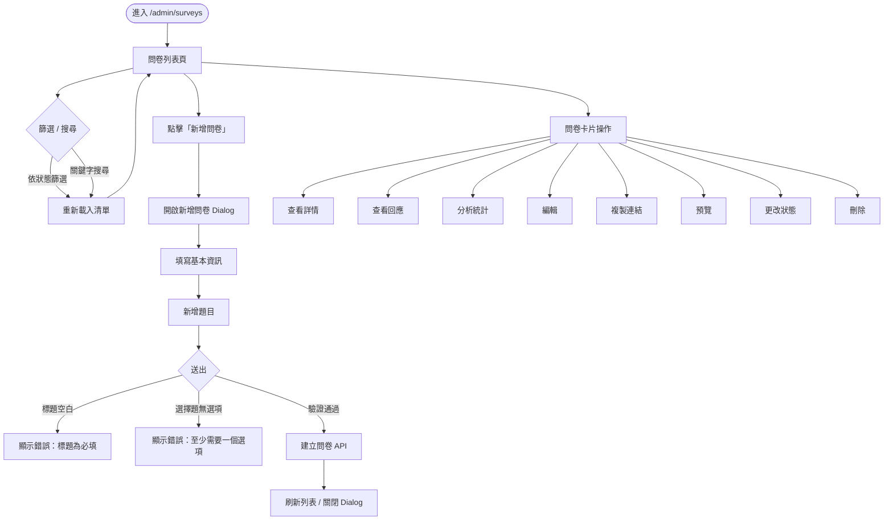
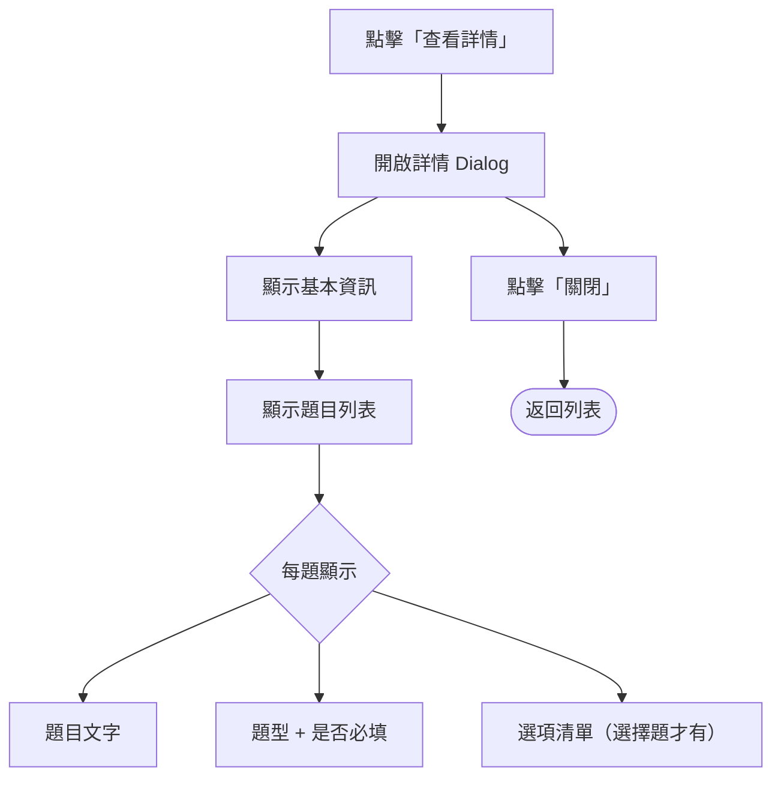
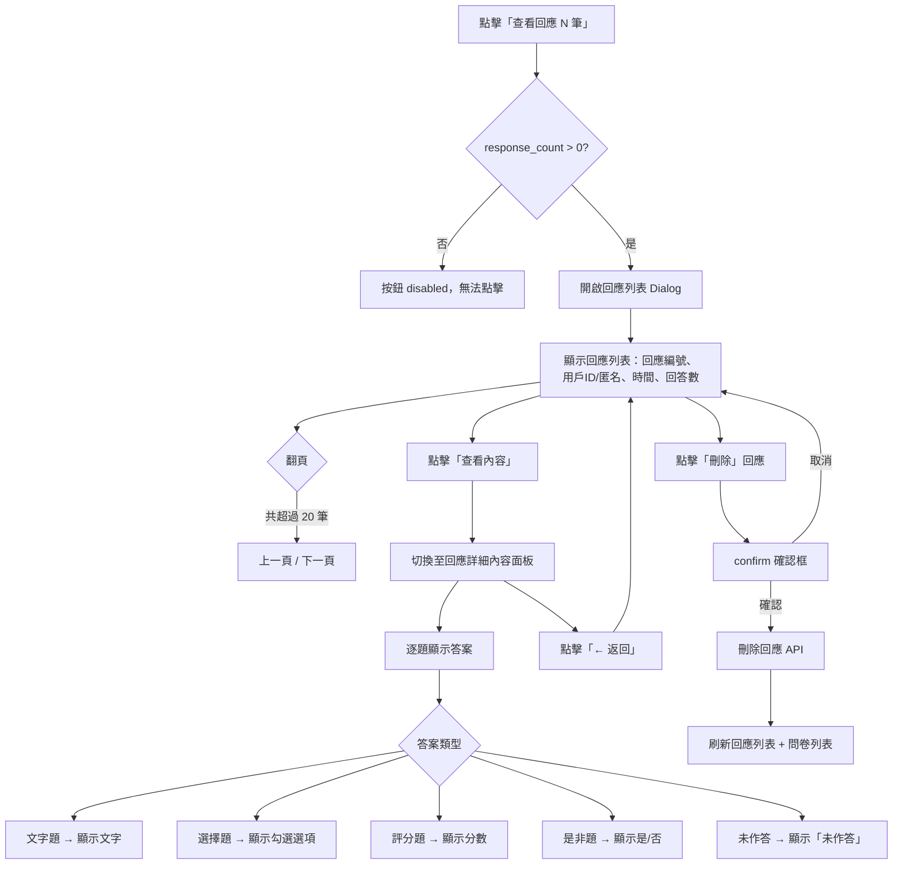
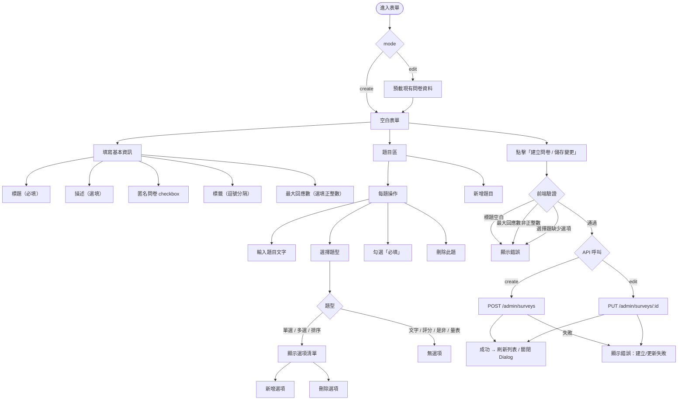
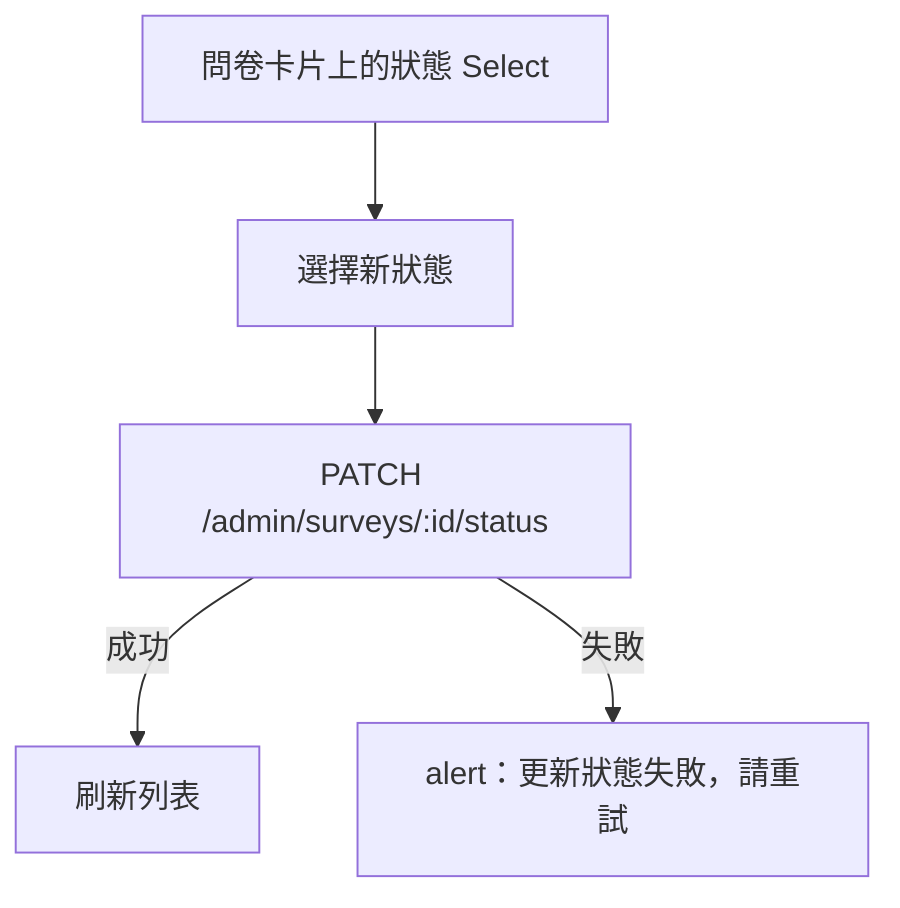
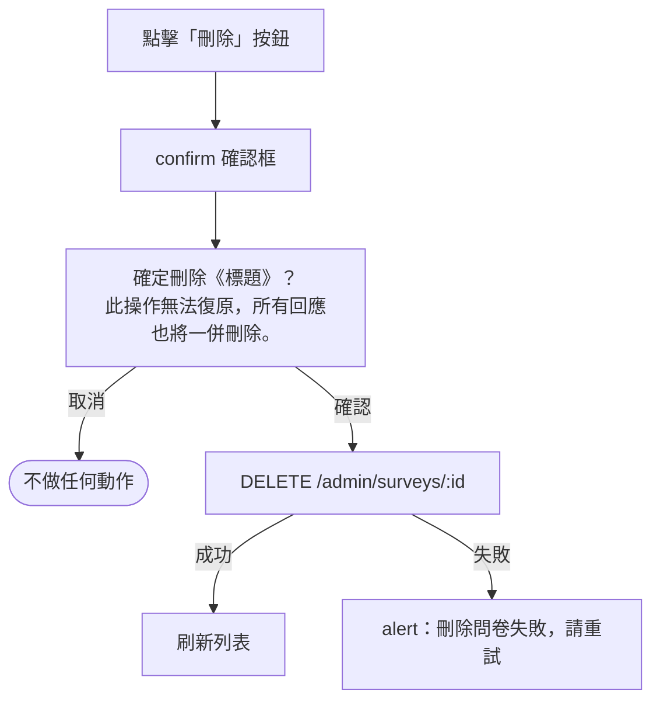
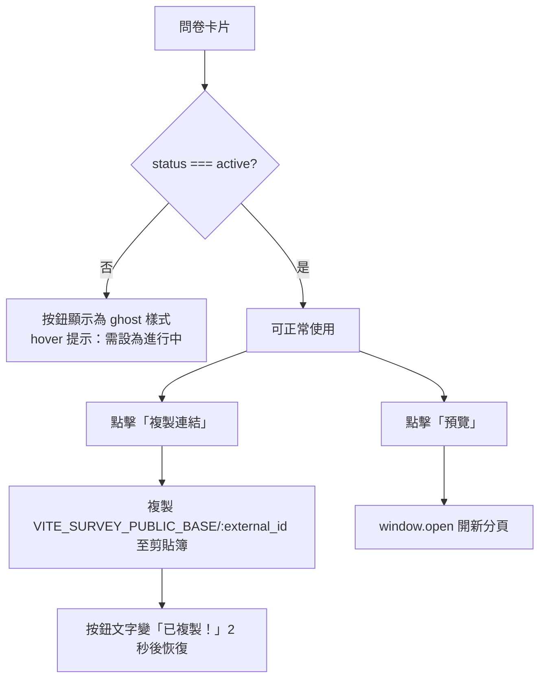
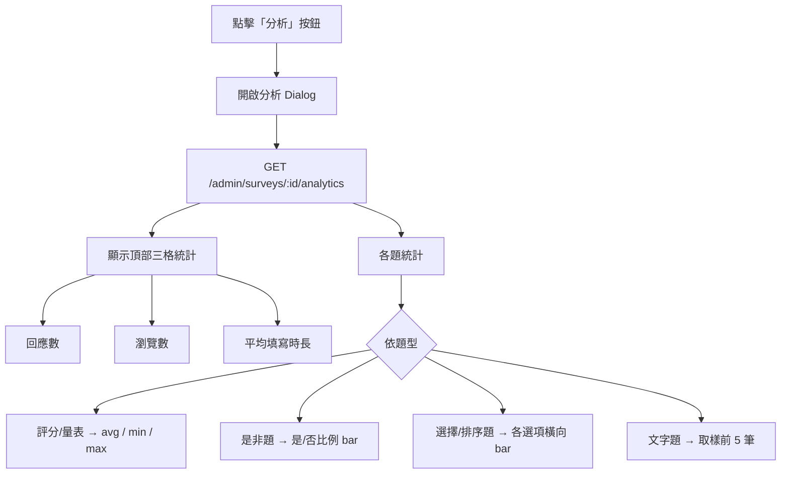
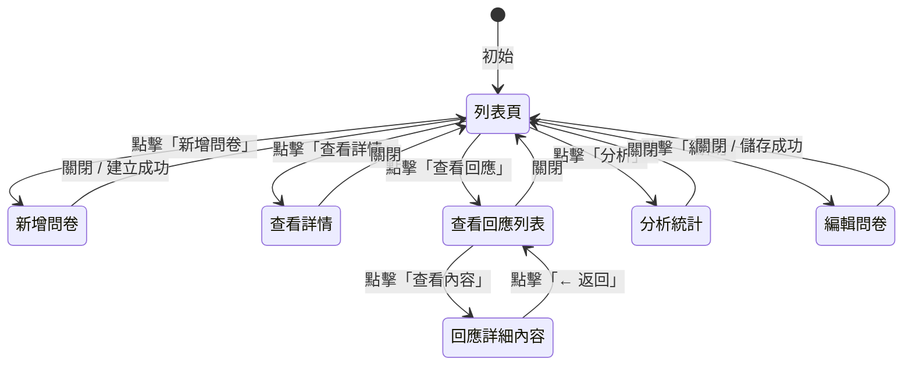

# 問卷管理功能流程圖

路徑：`/admin/surveys`

---

## 整體使用者流程



---

## 查看詳情流程



---

## 查看回應流程



---

## 新增 / 編輯問卷流程



---

## 更改狀態流程



**可用狀態：**

| 狀態 | 說明 |
|------|------|
| `draft` | 草稿，尚未開放 |
| `active` | 進行中，開放填寫 |
| `closed` | 已關閉，不可再填寫 |
| `archived` | 已封存 |

---

## 刪除問卷流程



---

## 複製連結 / 預覽流程



**公開問卷 URL 格式：**

```
{APP_BASE_URL}/survey/r/{external_id}
```

| admin 主機 | APP_BASE_URL |
|------|------------------------|
| `admin-dev.daodao.so` | `https://app-dev.daodao.so` |
| `admin.daodao.so` | `https://app.daodao.so` |

> **重要**：問卷必須設為 `active` 狀態，前端填寫頁才能正常載入。
> `draft` / `closed` / `archived` 狀態的問卷在前端會返回 404。

---

## 分析統計流程



---

## Dialog 面板切換狀態機



---

## 題型說明

| 題型 | 顯示名稱 | 需要選項 | 回答格式 |
|------|----------|----------|----------|
| `single_choice` | 單選 | 是 | `selected_option_ids` (1個) |
| `multiple_choice` | 多選 | 是 | `selected_option_ids` (多個) |
| `ranking` | 排序 | 是 | `selected_option_ids` (排序) |
| `text` | 文字 | 否 | `answer_text` |
| `rating` | 評分 | 否 | `rating_value` (0–10) |
| `scale` | 量表 | 否 | `rating_value` |
| `yesno` | 是非 | 否 | `boolean_value` |

---

## API 對應表

| 操作 | Method | 路徑 |
|------|--------|------|
| 取得列表 | GET | `/api/v1/admin/surveys` |
| 取得詳情 | GET | `/api/v1/admin/surveys/:id` |
| 建立問卷 | POST | `/api/v1/admin/surveys` |
| 編輯問卷 | PUT | `/api/v1/admin/surveys/:id` |
| 更改狀態 | PATCH | `/api/v1/admin/surveys/:id/status` |
| 刪除問卷 | DELETE | `/api/v1/admin/surveys/:id` |
| 取得回應列表 | GET | `/api/v1/admin/surveys/:id/responses` |
| 取得回應詳情 | GET | `/api/v1/admin/surveys/:id/responses/:responseId` |
| 刪除回應 | DELETE | `/api/v1/admin/surveys/:id/responses/:responseId` |
| 取得分析統計 | GET | `/api/v1/admin/surveys/:id/analytics` |

---

## 環境設定

### admin-ui（`APP_BASE_URL`，`src/config.ts`）

前台網址由 `resolveAppBaseUrl()` 依序決定：

1. 已部署主機固定對應：`admin-dev.daodao.so` → `https://app-dev.daodao.so`；`admin.daodao.so` → `https://app.daodao.so`
2. `VITE_SURVEY_PUBLIC_BASE`（本機開發用，可寫 `https://…/survey/r` 或只寫 origin）
3. 本機（localhost／127.0.0.1）沒設定 → `https://app-dev.daodao.so`
4. 其他 → `https://app.daodao.so`

> `VITE_*` 只在 `pnpm build` 時注入。部署用的 Docker image 在 CI build、不帶這個值，`.env.dev`／`.env.prod` 是容器啟動時才掛載，寫在裡面不會影響已打包的前端（#525 admin-dev 連結開到 prod 的原因）。

### daodao-f2e（`NEXT_PUBLIC_API_URL`）

問卷 service (`features/survey/services/survey.ts`) 的 API base URL 為：

```typescript
`${NEXT_PUBLIC_API_URL}/api/v1`
```

| 環境 | NEXT_PUBLIC_API_URL |
|------|---------------------|
| dev  | `https://server-dev.daodao.so` |
| prod | `https://server.daodao.so` |

所有問卷 API 路徑（`/surveys/...`）都會加上 `/api/v1` 前綴後送出。
